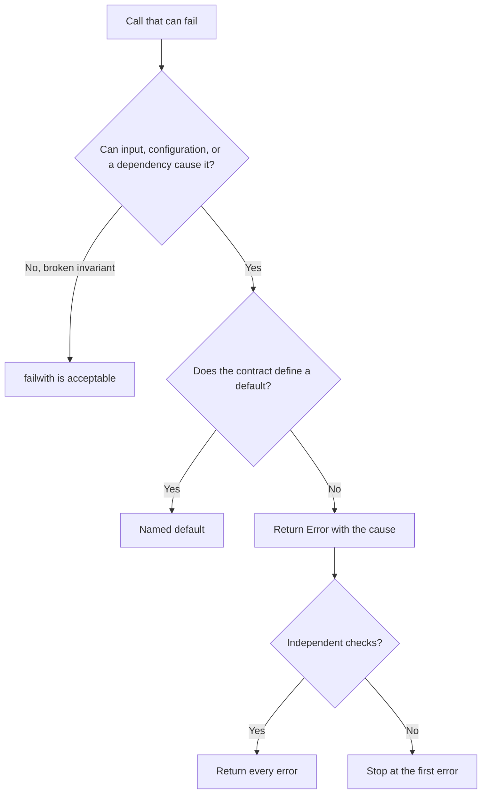

# Failure path patterns

Each pattern compiles in its unsafe form. [scripts/FailurePaths.fsx](../scripts/FailurePaths.fsx) runs both forms.

## Partial functions

| Partial | Fails on | Safe form |
| --- | --- | --- |
| `List.head`, `Seq.head`, `Array.head` | empty collection (`ArgumentException`) | `List.tryHead`, or `match xs with [] -> ... \| x :: _ -> ...` |
| `List.find`, `Seq.find` | no match (`KeyNotFoundException`) | `List.tryFind`, `Seq.tryFind` |
| `Map.find`, `dict.[key]` | missing key (`KeyNotFoundException`) | `Map.tryFind`, `TryGetValue` |
| `Option.get`, `.Value` | `None` (`NullReferenceException` for `.Value`) | pattern match |
| `List.reduce`, `Seq.max`, `List.average` | empty collection | `List.fold` with a seed, or handle empty first |
| `List.item`, `xs.[i]` | index out of range | `List.tryItem` |

```fsharp
let convert (rates: Map<string, decimal>) amount =
    match Map.tryFind amount.Currency rates with
    | Some rate -> Ok(amount.Value * rate)
    | None -> Error(MissingRate amount.Currency)
```

A comment such as "a batch has at least one item" is not a guarantee. If the type allows an empty list, handle it, or change the type with [parse-dont-validate](../../parse-dont-validate/SKILL.md).

## failwith

Acceptable: an invariant that the code itself establishes and that no input can break, in a script's top-level setup, or at a process entry point that must stop.

Not acceptable: library code that input, configuration, or a dependency can reach. Return `Error`.

```fsharp
match checkItems items with
| Ok valid -> valid
| Error e -> failwith e // turns a reported error back into a crash
```

## Hidden fallbacks

```fsharp
let region settings = defaultArg (Map.tryFind "region" settings) "us-east"
```

After the global region default is removed, every tenant without the key silently uses `us-east`.
The caller cannot tell "unset" from "us-east". Report the absence:

```fsharp
let region settings =
    match Map.tryFind "region" settings with
    | Some r -> Ok r
    | None -> Error(MissingSetting "region")
```

Keep a default only when the contract states it, and name it in the code, for example `defaultPageSize`.

## Swallowed exceptions

```fsharp
let loadRates fetch = try fetch () with _ -> Map.empty
```

A failed fetch becomes an empty rate table. The next step then reports "no rate for EUR", which is the wrong cause.
Keep the cause:

```fsharp
let loadRates fetch = try Ok(fetch ()) with ex -> Error(RatesUnavailable ex)
```

Catch only the exception types that you expect when other exceptions are bugs.

## Error accumulation

```fsharp
if List.isEmpty errors then Ok items else Error(List.head errors)
```

The user fixes one error, submits, and sees the next. Return the list:

```fsharp
match errors with
| [] -> Ok valid
| errors -> Error(InvalidItems errors)
```

With FsToolkit.ErrorHandling, `validation { let! a = ... and! b = ... }` collects errors from independent checks. Use `result` only when a later check depends on an earlier value.

## Reversed guards

```fsharp
let requireTrueWith error condition = if condition then Error error else Ok()
```

This compiles and rejects every valid input. Test each guard with a true and a false condition.

## Flow


